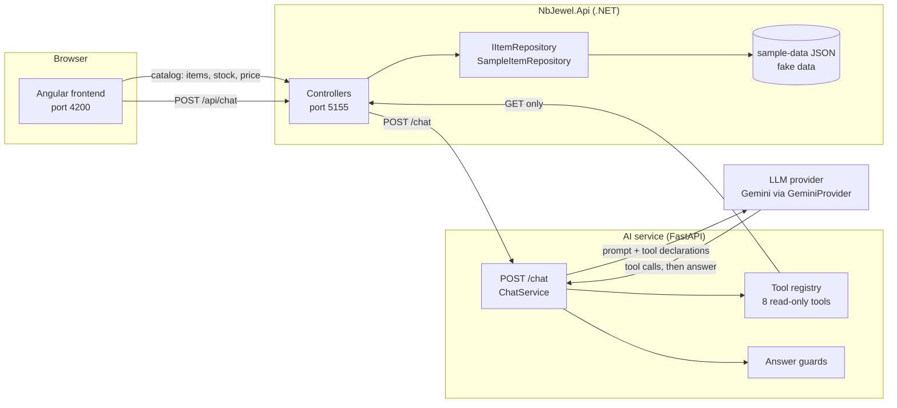
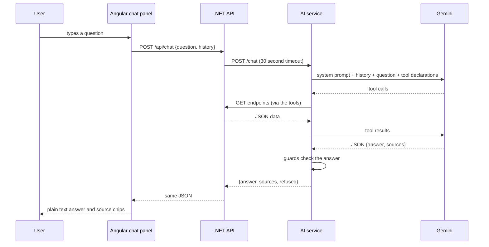

# Architecture

This document describes what is built today. Anything about NB Jewel itself is marked "assumed", because this repository uses fake sample data only. Anything not built is marked "not built".

## Components

| Part | Folder | Port | What it does today |
|---|---|---|---|
| Angular frontend | `frontend/` | 4200 | Themed shell, static mock pages, catalog (list, filters, detail with tabs, create and edit form), chat panel |
| .NET Web API | `backend/NbJewel.Api` | 5155 | Item, stock, price, category, store and metal rate endpoints, plus `POST /api/chat` that forwards to the AI service |
| AI service | `ai-service/` | 8000 | FastAPI app with `GET /health` and `POST /chat`, eight read-only tools, answer guards, Gemini provider |
| LLM provider | (external) | n/a | Google Gemini, called only from the AI service through `GeminiProvider` |
| Sample data layer | `sample-data/`, `SampleItemRepository` | n/a | Fake JSON files read by the .NET API through `IItemRepository` |

## Diagram

The frontend never talks to the AI service or the LLM. The AI service never reads the data files. It asks the .NET API, using GET requests only.

## Request flow for one chat question

1. The user types a question in the chat panel (1 to 500 characters). `ChatService` sends `POST {apiBaseUrl}/api/chat` with the question and the last 6 messages as history.
2. `ChatController` in the .NET API rejects blank or over-long questions with 400. Otherwise it forwards the request to `AI_SERVICE_URL` (default `http://localhost:8000`) with a 30 second timeout.
3. The AI service checks the request shape. `ChatService` builds the conversation: the system prompt, up to 6 history messages, the question, and the 8 tool declarations. It calls Gemini at temperature 0.1.
4. If Gemini asks for tools, each one runs through `ToolRegistry.run_tool`. At most 5 tool calls are allowed per question. Each tool sends GET requests to the .NET API. Any other HTTP method is blocked in code.
5. The .NET API answers from `IItemRepository`, which reads the sample JSON. The tool wraps the result as `{status, data, sources}` and it goes back to Gemini.
6. Gemini returns JSON: `{"answer": ..., "sources": [...]}`. If the reply is not valid JSON, the service asks once more, then refuses.
7. Four guards check the answer (see `grounding-design.md`). If any fails, the answer becomes the fixed refusal: "I can only answer from NB Jewel data. I have no tool for that."
8. The AI service returns `{answer, sources, refused}`. The .NET API passes it on. The panel shows the answer as plain text. Source chips open `/catalog/:id` when the record is a real item.

If the AI service is down, slow, or Gemini is not configured, the .NET API returns 503 with `{"message": "Assistant unavailable. Retry."}` and the panel shows the same text with a Retry button.

## Swap plan: sample data to SQL Server or the real NB Jewel API

The data source is hidden behind one interface, `IItemRepository` (`backend/NbJewel.Api/Repositories/IItemRepository.cs`). Today `SampleItemRepository` implements it by reading `sample-data/*.json`, and `Program.cs` registers it as a singleton.

To switch:

1. Write a new class that implements `IItemRepository`, for example `SqlItemRepository` (SQL Server) or `ErpApiItemRepository` (an HTTP client to the real NB Jewel API). **Assumed:** one of these two is the real target. This is an open question, see `questions-for-sakthivel.md`.
2. In `Program.cs`, register the new class instead of `SampleItemRepository`.
3. Nothing else changes for the existing features. The controllers, the response shapes, the AI service tools and the Angular screens all depend on the API contract, not on the repository.

Work the swap does not cover (not built):

- The repository interface includes create, update and status change. A real ERP may be read-only for this app, so those methods may need to be removed or refused.
- The price calculation lives inside `SampleItemRepository.GetPriceAsync`. A real implementation must reproduce the real pricing rules or call the ERP for the price.
- Variants and images have no .NET endpoints. The frontend serves them from `InMemorySampleDataService` (fake, resets on reload). Real endpoints and a matching change in `HttpItemDataService` are needed.
- The stock API has no "last updated" value. The Stock tab shows "Not available".
- `list_low_stock` is built in the AI service from many calls (one per item). With real data it needs a proper API endpoint.
- Authentication and authorization are not built anywhere.

## Assumed details

Everything below is a guess about NB Jewel, used only to build the demo. None of it is confirmed.

- **Assumed:** The business sells jewelry items made of a metal and a purity (22K, 18K, 24K, 925), priced from a daily rate per gram plus a making charge.
- **Assumed:** Making charge comes in three types: per gram, percent of metal value, or a flat amount.
- **Assumed:** There is one rate per metal and purity, in AED, with an effective date. The "latest" rate is the one with the newest date.
- **Assumed:** Stock is tracked per item per store, with on hand and reserved counts. The demo uses three stores (Dubai, Chennai, Bengaluru).
- **Assumed:** An item has a code (for example RNG-0142), a design code, a HUID, gross, net and stone weights, and a status of Active, Draft or Discontinued.
- **Assumed:** Categories form a tree with one root ("Jewelry").
- **Assumed:** Items can have variants (size and color) and images. The demo data for these is invented.
- **Assumed:** The real system is either Business Central or a .NET application on SQL Server.
- **Assumed:** Field names in the sample data are illustrative and do not match NB Jewel's real schema.
