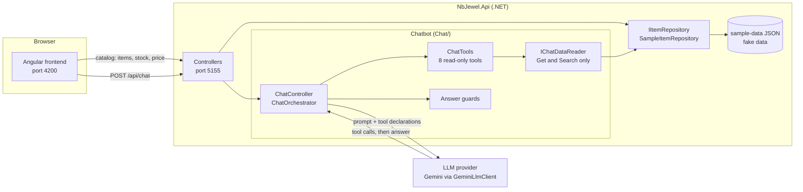
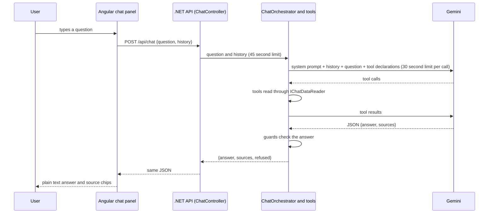

# Architecture

This document describes what is built today. Anything about NB Jewel itself is marked "assumed", because this repository uses fake sample data only. Anything not built is marked "not built".

## Components

| Part | Folder | Port | What it does today |
|---|---|---|---|
| Angular frontend | `frontend/` | 4200 | Themed shell, static mock pages, catalog (list, filters, detail with tabs, create and edit form), chat panel |
| .NET Web API | `backend/NbJewel.Api` | 5155 | Item, stock, price, category, store and metal rate endpoints, plus `POST /api/chat`, the chatbot (eight read-only tools, answer guards, Gemini client) in `backend/NbJewel.Api/Chat/` |
| LLM provider | (external) | n/a | Google Gemini, called only from the .NET API through `GeminiLlmClient` (the `ILlmClient` interface) |
| Sample data layer | `sample-data/`, `SampleItemRepository` | n/a | Fake JSON files read by the .NET API through `IItemRepository` |

## Diagram

The frontend never talks to the LLM. The chatbot never reads the data files directly. Its tools reach data only through `IChatDataReader`, a read-only door over the same `IItemRepository` the controllers use.

## Request flow for one chat question

1. The user types a question in the chat panel (1 to 500 characters). `ChatService` sends `POST {apiBaseUrl}/api/chat` with the question and the last 6 messages as history.
2. `ChatController` rejects blank or over-long questions, and a bad history, with 400. Otherwise it hands the question to `ChatOrchestrator` with a 45 second limit for the whole question.
3. `ChatOrchestrator` builds the conversation: the system prompt, up to 6 history messages, the question, and the 8 tool declarations. It calls Gemini at temperature 0.1, with a 30 second limit per call. At most 8 model calls are allowed per question.
4. If Gemini asks for tools, each one runs in `ChatTools`. At most 5 tool calls are allowed per question. Each tool reads through `IChatDataReader`, which has only Get and Search methods, so nothing can be written.
5. `IChatDataReader` passes the call to `IItemRepository` (sample JSON or SQL Server). The tool wraps the result as `{status, data, sources}` and it goes back to Gemini.
6. Gemini returns JSON: `{"answer": ..., "sources": [...]}`. If the reply is not valid JSON, the orchestrator asks once more, then refuses.
7. Five guards check the answer (see `grounding-design.md`). If any fails, the answer becomes the fixed refusal: "I can only answer from NB Jewel data. I have no tool for that."
8. The controller returns `{answer, sources, refused}`. The panel shows the answer as plain text. Source chips open `/catalog/:id` when the record is a real item.

If Gemini is not configured, fails, or is too slow, the .NET API returns 503 with `{"message": "The assistant is busy. Please try again."}` and the panel shows the same text with a Retry button.

## Swap plan: sample data to SQL Server or the real NB Jewel API

The data source is hidden behind one interface, `IItemRepository` (`backend/NbJewel.Api/Repositories/IItemRepository.cs`). Two classes implement it:

- `SampleItemRepository` reads `sample-data/*.json` and keeps changes in memory only. This is the default.
- `SqlItemRepository` reads and writes SQL Server, using the tables in `item_catalog_schema.sql`. It uses fixed, parameterized queries only (no free SQL).

`Program.cs` registers one of them as a singleton, chosen by a config setting:

| Setting | Value | Effect |
|---|---|---|
| `Repository:Provider` (in `appsettings.json`) | `Sample` (default) | Sample JSON, in memory |
| `Repository:Provider` | `Sql` | SQL Server |
| `NBJEWEL_SQL_CONNECTION` (environment variable) | a SQL Server connection string | Required when the provider is `Sql`. The API stops at start with a clear message if it is missing. It is never stored in the repo. |

To switch to a different source later:

1. Write another class that implements `IItemRepository`, for example `ErpApiItemRepository` (an HTTP client to the real NB Jewel API). **Assumed:** SQL Server or the real NB Jewel API is the real target. This is an open question, see `questions-for-sakthivel.md`.
2. Add it to the provider switch in `Program.cs`.
3. Nothing else changes for the existing features. The controllers, the response shapes, the chatbot tools and the Angular screens all depend on the API contract, not on the repository.

`SqlItemRepository` is build-checked only. It has not been run against a SQL Server in this repository, because no server was available.

## Writes and the chatbot

Writes happen only through the UI API: create and edit an item, move an item status, and add stock. The chatbot tools can only use `IChatDataReader`, which has Get and Search methods only, so they stay read-only and none of the write methods is reachable from them. This is a code rule checked in review and tests, not a network rule.

| Write | Endpoint | Rule |
|---|---|---|
| Set status | `PATCH /api/items/{id}/status` | Any of the four statuses, from any status (assumed). Choosing the current status is a harmless 200 and changes nothing. An unknown status returns 400. |
| Add stock | `POST /api/items/{id}/stock` | Body `{variantId, storeId, quantity}`. The quantity is added to on-hand. 0 or less returns 400. |
| Create item | `POST /api/items` | Always starts as Draft. `designId` must exist in the design master. |
| Edit item | `PUT /api/items/{id}` | Never changes status. |

The list of valid statuses lives in one class, `ItemStatusRules`, which both repositories call, so the sample and SQL versions cannot drift apart.

Status and stock changes made in the default sample mode live in the API's memory only. They reset to the values in `sample-data/` whenever the API restarts. For example, if you move BNG-0011 to Complete and later restart the API, it is Draft again.

Work the swap does not cover (not built):

- The repository interface includes create, update, status change and add stock. A real ERP may be read-only for this app, so those methods may need to be removed or refused.
- The price calculation lives in `ItemPricing` (used by both repositories). A real implementation must reproduce the real pricing rules or call the ERP for the price. It ignores the stone charge column in the SQL schema.
- Images have no .NET endpoints. The frontend serves them from `InMemorySampleDataService` (fake, resets on reload). Real endpoints and a matching change in `HttpItemDataService` are needed.
- The SQL schema has no color, price delta, reserved or currency columns. `SqlItemRepository` returns an empty color, a price delta of 0, reserved 0 and the currency AED for these. This is assumed and needs the real schema.
- In the SQL schema, stock belongs to a variant, so an item with no variant cannot hold stock there. The sample repository allows stock on an item with no variant.
- The stock API has no "last updated" value. The Stock tab shows "Not available".
- `list_low_stock` is built in `ChatTools.cs` from all items and their stock, not from `GET /api/stock/low`. It uses the same rule as the dashboard (fewer than 2 available) but judges the total per item. The read-only endpoint `GET /api/stock/low` exists now for the dashboard; moving the tool onto it is a later option and would change the answers from per item to per variant and store.
- Authentication and authorization are not built anywhere.

## Assumed details

Everything below is a guess about NB Jewel, used only to build the demo. None of it is confirmed.

- **Assumed:** The business sells jewelry items made of a metal and a purity (22K, 18K, 24K, 925), priced from a daily rate per gram plus a making charge.
- **Assumed:** Making charge comes in three types: per gram, percent of metal value, or a flat amount.
- **Assumed:** There is one rate per metal and purity, in AED, with an effective date. The "latest" rate is the one with the newest date.
- **Assumed:** Stock is tracked per variant per store (or per item per store when an item has no variants), with on hand and reserved counts. The demo uses three stores (Dubai, Chennai, Bengaluru).
- **Assumed:** Adding stock ADDS the entered quantity to on-hand. The quantity must be above 0. (The product manager wrote "0 or more". The project owner changed it to above 0, because adding 0 does nothing.)
- **Assumed:** An item has a code (for example RNG-0142), a design (chosen from a design master), a HUID, gross, net and stone weights, and a status.
- **Assumed:** The design master is what the product manager called the "master chit". It has a design id, a design code and a name. Many items can share one design. The demo has 10 designs.
- **Assumed:** The status workflow is Draft, With Smith, Received, Complete. **Any-to-any is assumed:** a user can pick any of the four statuses at any time (forward, backward, or skipping), and Complete is not final. Only an unknown status is refused (HTTP 400). "With Smith" is assumed to mean the piece is out with the craftsman. The UI asks for confirmation before a backward move.
- **Assumed:** Old sample statuses were remapped: Active to Complete, Discontinued to Complete, and Draft stays Draft. Discontinued has no place in the new workflow, so that information is lost in the demo data.
- **Assumed:** Categories form a tree with one root ("Jewelry").
- **Assumed:** Items can have variants (size and color) and images. The demo data for these is invented. Variants now come from the API (`sample-data/variants.json`). Images are still fake in the frontend.
- **Assumed:** The real system is either Business Central or a .NET application on SQL Server.
- **Assumed:** Field names in the sample data are illustrative and do not match NB Jewel's real schema.
